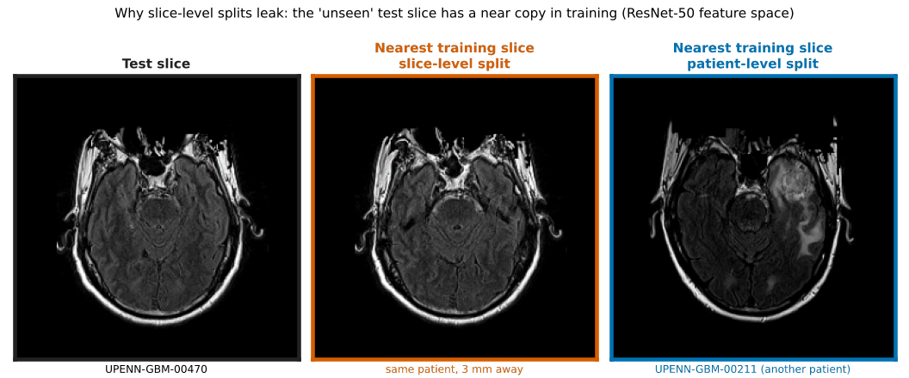
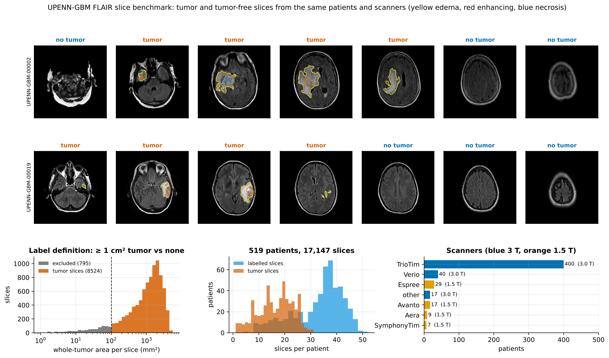
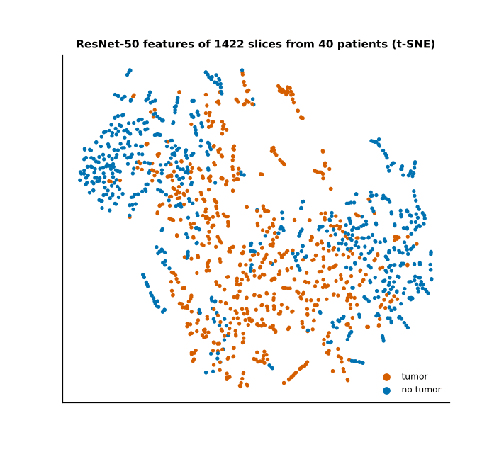
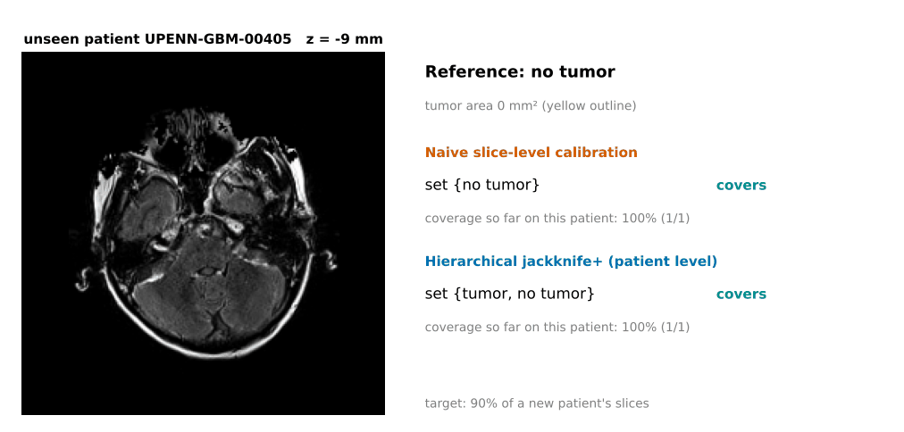

# Patients, not slices

### Honest, calibrated brain-tumor detection on MRI: leakage-controlled evaluation, closed-form learners with exact leave-one-patient-out, and patient-level conformal guarantees on 519 glioblastoma patients

[](https://github.com/MehranKeivanimehr/Brain-Tumor-Detection/actions/workflows/ci.yml)

-informational)


<p align="center">
  
</p>

Public brain-tumor MRI classifiers routinely report 95–99% accuracy. This
repository started as one of them, and the first thing it does is show why its
own 90% was not real. It then rebuilds the problem properly, on research-grade
data with the **patient** as the unit of analysis everywhere, and asks two
questions that matter more than accuracy:

1. **How much of a reported score is the patient, not the pathology?**
2. **Can a model give guarantees that hold for the next, unseen patient?**

**Main findings**

| Question | Answer |
|---|---|
| Was the original 90% real? | **No.** 18 of 21 test images were copies of training images and the model was chosen on the test set. Under a duplicate-aware split the same ELM scores 54%, below the 62% majority baseline. |
| How much do slice-level splits inflate results? | **Every one of 16 models is inflated**, by up to 8.1 balanced-accuracy points. For 71% of "unseen" test slices, the nearest training slice belongs to the same patient and lies a median of 3 mm away. |
| What is the honest performance? | **AUC 0.965 [0.960, 0.969]**, balanced accuracy 90.3% on new patients (DenseNet-121 features, logistic regression). |
| Can leave-one-patient-out be made cheap? | **Yes, exactly.** One factorisation gives every leave-one-patient-out ridge or ELM model. It matches refitting to 3.5 × 10⁻¹³ and is 170× faster at 400 patients. |
| Can a model guarantee coverage on new patients? | **On average, yes.** Patient-level hierarchical jackknife+ gives 90.2% coverage at a 90% target in all four models, while calibrating on seen patients falls short in 56 of 60 folds. The guarantee does not hold for each patient (the worst tenth get about 80%) or on new scanners (86%). |
| What does a Kaggle-style source cue do? | **It inflates the benchmark to 98.9% balanced accuracy**, even with patient-level splits. On the same patients without the cue the model scores 64.2%, and its conformal sets, valid on the biased data, cover only 50% of clean slices. |

## Contents

1. [Chapter zero: the original 90%](#1-chapter-zero-the-original-90)
2. [A benchmark that cannot be solved by shortcuts](#2-a-benchmark-that-cannot-be-solved-by-shortcuts)
3. [How much do slice-level splits inflate results?](#3-how-much-do-slice-level-splits-inflate-results)
4. [Exact leave-one-patient-out for closed-form learners](#4-exact-leave-one-patient-out-for-closed-form-learners)
5. [Patient-level conformal prediction](#5-patient-level-conformal-prediction)
6. [Stress tests: new scanners and a Kaggle-style shortcut](#6-stress-tests-new-scanners-and-a-kaggle-style-shortcut)
7. [Reproduce](#7-reproduce)
8. [Repository layout](#8-repository-layout)
9. [Limitations](#9-limitations)
10. [References](#10-references)

---

## 1. Chapter zero: the original 90%

The 2023 version of this repo (kept unchanged in [`legacy/`](legacy)) detected
tumors in the 253-slice Kaggle dataset with Gabor/GMM segmentation, DWT, GLCM and
LBP features and an extreme learning machine (ELM). Its saved feature files make
the result auditable without the images:


<!-- TABLE:legacy -->
| Protocol | Accuracy | Note |
|---|---|---|
| Accuracy reported by the original notebook | 90.0% | image-level split, test images counted twice |
| ELM, best of 10 seeds chosen on the test set (main.m) | 69.5% | max 85.7% over 200 repetitions |
| ELM, a single seed, original split | 55.4% ± 9.4 | 2,000 seeds |
| Majority class on the original test set | 61.9% | always 'tumor' |
| ELM as configured, 5-fold CV grouped by duplicate image | 54.4% | 225 unique images |
| ELM without the broken IDM feature, 20 hidden units | 71.4% |  |
| Logistic regression, all 69 features | 73.3% |  |
| Logistic regression, LBP only (no segmentation) | 75.0% |  |
| Logistic regression, segmentation-derived features only | 65.9% |  |

18 of 21 test images are copies of training images (identical LBP feature vectors); the 13 tumor test images are only 8 distinct images; the training set contains 29 identical pairs.
<!-- /TABLE:legacy -->

The full audit, including the bugs (an "inverse difference moment" computed over
pixel coordinates, a constant "smoothness" feature, randomly inverted masks),
is in [`docs/legacy_audit.md`](docs/legacy_audit.md). An independent 2026 audit
of the public Kaggle brain-tumor corpora (Vangala et al., preprint) finds the
same problems at scale: duplicates across train and test, and file-format cues
that separate the classes without any anatomy.

## 2. A benchmark that cannot be solved by shortcuts

A tumor / no-tumor dataset whose two classes come from different sources cannot
show whether a model recognises tumors. The study therefore uses **UPENN-GBM**
(Bakas et al. 2022): pre-operative FLAIR MRI of 519 glioblastoma patients with
automatic nnU-Net tumor segmentations (AIMI, Murugesan et al. 2025), downloaded
from the NCI Imaging Data Commons (Fedorov et al. 2023). For 52 of these
patients a radiologist-corrected segmentation is also available. **Tumor and
tumor-free slices come from the same patients, scanners and acquisitions**, so
the only thing that separates the classes is the tumor.



* **17,147 labelled slices**: 8,524 with ≥ 1 cm² of tumor, 8,623 with none; the 795
  slices in between are excluded. Slices are resampled to 1 mm, 240 × 240 mm.
* **A data-engineering finding:** every AIMI segmentation object in this
  collection stores its rows flipped relative to the FLAIR images. Decoding by
  referenced image UID (the obvious way) silently turns every mask upside down.
  The loader maps masks through patient coordinates, a unit test reproduces the
  trap with a synthetic DICOM-SEG, and every patient passes an image-based
  alignment check ([`docs/data.md`](docs/data.md)).

## 3. How much do slice-level splits inflate results?

Four feature families are compared: the handcrafted DWT/GLCM/LBP texture
features of the original repo, wavelet scattering (Bruna & Mallat 2013, via
Kymatio, Andreux et al. 2020), and frozen ImageNet ResNet-50 (He et al. 2016) and
DenseNet-121 (Huang et al. 2017) features. The last two follow the deep-feature
design of Kang et al. (2021). Each is paired with four heads: ridge, ELM,
logistic regression and 15-nearest neighbours. Every combination is evaluated
twice with 5-fold cross-validation:
splitting **slices** at random (what most published pipelines do) and splitting
**patients**. Hyper-parameters are tuned inside the training folds with the same
unit. Confidence intervals come from a patient-level bootstrap.

<!-- TABLE:benchmark -->
| Features | Head | AUC, slice split | AUC, patient split [95% CI] | bAcc %, slice split | bAcc %, patient split [95% CI] | Inflation (bAcc pts) | ECE, patient split |
|---|---|---|---|---|---|---|---|
| Classical texture (DWT+GLCM+LBP) | Ridge | 0.911 | **0.903** [0.892, 0.913] | 82.5 | **81.9** [80.6, 83.1] | +0.6 | 0.016 |
| Classical texture (DWT+GLCM+LBP) | ELM | 0.956 | **0.913** [0.903, 0.922] | 88.7 | **83.2** [82.1, 84.3] | +5.5 | 0.020 |
| Classical texture (DWT+GLCM+LBP) | Logistic | 0.907 | **0.900** [0.889, 0.910] | 82.2 | **81.5** [80.3, 82.7] | +0.6 | 0.023 |
| Classical texture (DWT+GLCM+LBP) | 15-NN | 0.932 | **0.846** [0.833, 0.859] | 84.6 | **76.5** [75.2, 77.8] | +8.1 | 0.051 |
| Wavelet scattering | Ridge | 0.896 | **0.878** [0.866, 0.888] | 81.8 | **79.8** [78.6, 81.0] | +2.0 | 0.012 |
| Wavelet scattering | ELM | 0.923 | **0.883** [0.871, 0.894] | 84.7 | **80.3** [79.1, 81.5] | +4.4 | 0.011 |
| Wavelet scattering | Logistic | 0.897 | **0.878** [0.867, 0.889] | 81.5 | **79.9** [78.7, 81.1] | +1.7 | 0.015 |
| Wavelet scattering | 15-NN | 0.902 | **0.811** [0.797, 0.825] | 81.7 | **73.7** [72.3, 75.1] | +8.0 | 0.038 |
| ResNet-50 (ImageNet) | Ridge | 0.968 | **0.953** [0.948, 0.958] | 90.8 | **88.6** [87.8, 89.5] | +2.1 | 0.012 |
| ResNet-50 (ImageNet) | ELM | 0.962 | **0.949** [0.944, 0.955] | 89.7 | **87.8** [87.0, 88.7] | +1.9 | 0.011 |
| ResNet-50 (ImageNet) | Logistic | 0.970 | **0.955** [0.950, 0.959] | 91.1 | **88.7** [87.9, 89.6] | +2.4 | 0.017 |
| ResNet-50 (ImageNet) | 15-NN | 0.948 | **0.909** [0.900, 0.918] | 86.7 | **82.4** [81.4, 83.4] | +4.3 | 0.021 |
| DenseNet-121 (ImageNet) | Ridge | 0.971 | **0.961** [0.957, 0.966] | 91.2 | **89.6** [88.8, 90.3] | +1.7 | 0.010 |
| DenseNet-121 (ImageNet) | ELM | 0.969 | **0.958** [0.953, 0.963] | 91.0 | **89.2** [88.5, 90.0] | +1.7 | 0.010 |
| DenseNet-121 (ImageNet) | Logistic | 0.973 | **0.965** [0.960, 0.969] | 91.7 | **90.3** [89.6, 90.9] | +1.4 | 0.011 |
| DenseNet-121 (ImageNet) | 15-NN | 0.961 | **0.906** [0.895, 0.916] | 88.9 | **82.3** [81.1, 83.5] | +6.6 | 0.027 |
<!-- /TABLE:benchmark -->


**What the table shows**

* **Slice-level splits inflated every one of the 16 configurations**: by +0.6 to
  +8.1 balanced-accuracy points and +0.007 to +0.091 AUC.
* **The inflation tracks how much a model can memorise patients.** It is smallest
  for linear heads (ridge, logistic: +0.6 to +2.4 points), larger for the ELM's
  random hidden layer (+1.7 to +5.5) and largest for nearest neighbours (+4.3 to
  +8.1). The original repo combined weak handcrafted features with an ELM, the
  combination that inflates most among the trained heads.
* **The mechanism is visible directly.** Under a slice-level split, the nearest
  training slice (in ResNet-50 feature space) of 71% of test slices belongs to
  the *same patient*, a median of 3 mm away: the adjacent slice. Copying its
  label scores 92.3%; with patients kept apart the same rule scores 78.5%. The
  same effect inflated Alzheimer's and Parkinson's classifiers by 29–55 points in
  Yagis et al. (2021). Wen et al. (2020) judged data leakage to be potentially
  present in 16 of the 32 CNN studies they surveyed (clearly in 6, possibly in
  10). The inflation is smaller here because the tumor signal itself is strong.
  Leakage of this kind is a recognised cause of irreproducible results in
  medical imaging and beyond (Tampu et al. 2022; Varoquaux & Cheplygina 2022;
  Kapoor & Narayanan 2023).
* **The honest numbers are still good.** The best patient-level result is
  DenseNet-121 features with logistic regression: AUC 0.965 [0.960, 0.969],
  balanced accuracy 90.3% (sensitivity 88.8%, specificity 91.7%). With
  out-of-patient Platt calibration (Platt 2000) the linear and ELM heads reach an
  expected calibration error (Guo et al. 2017) of 0.010–0.023.
* **The ELM helps only where features are weak.** On the handcrafted features
  its random hidden layer adds about one AUC point over ridge (0.913 vs 0.903);
  on pretrained CNN features it matches, but does not beat, the linear heads.
* **Errors are concentrated in small tumors.** Probabilities calibrated on
  out-of-patient scores are reliable (ECE 0.011 for the ResNet-50 ELM).
  Sensitivity is 38% for tumor cross-sections of 1–2 cm², against 99% above
  16 cm². Slices with less than 4 cm² of tumor are 15% of tumor slices but 52%
  of the misses.


<p align="center">
  
</p>

## 4. Exact leave-one-patient-out for closed-form learners

The original ELM is a random hidden layer plus a least-squares readout. In
modern terms it is a closed-form, random-feature head (Huang et al. 2006; Rahimi
& Recht 2007), and that algebra has a useful property. For ridge regression on
any fixed feature map, deleting a whole patient `G` has an exact closed form
(Woodbury identity, Hager 1989; Cook & Weisberg 1982):

```
B₋G = B − A⁻¹ Φ_Gᵀ (I − H_GG)⁻¹ E_G          H_GG = Φ_G A⁻¹ Φ_Gᵀ,  E_G = T_G − Φ_G B
```

One factorisation then gives every leave-one-patient-out (LOPO) prediction and
every leave-one-patient-out *model*, exactly. They are used three times:

* tuning the penalty by exact LOPO instead of a noisy inner split;
* calibrating probabilities (Platt) on out-of-patient scores;
* building patient-level jackknife+ prediction sets (next section) at the cost of one fit.


Against brute-force refitting (ELM head, 2048 random features, ResNet-50
inputs, 4 CPU cores), the closed form agrees to **≤ 3.5 × 10⁻¹³** at every size,
and the gap in cost grows with the cohort:

| training patients | closed form | refit once per patient | speed-up |
|---|---|---|---|
| 25 | 1.3 s | 12 s | 9× |
| 50 | 1.2 s | 25 s | 22× |
| 100 | 1.7 s | 77 s | 44× |
| 200 | 4.1 s | 297 s | 73× |
| 400 | 6.0 s | 1,017 s | **170×** |

The closed form holds the input standardisation fixed. Re-estimating it without
each patient changes the out-of-patient decisions negligibly (r = 0.99995, 99.8%
sign agreement at 100 patients). The identities are unit-tested against
brute-force refits for ridge, ELM, binary and multi-class heads.

## 5. Patient-level conformal prediction

Conformal prediction (Vovk et al. 2005; Lei et al. 2018; Angelopoulos & Bates
2023) turns any classifier into prediction sets with a coverage guarantee. A
prediction set (`{tumor}`, `{no tumor}` or both) should contain the true label
for at least 90% of slices **of a new patient**. Slices of one patient are not
exchangeable with slices of another, so calibrating on slices of patients the
model has already seen is invalid (Dunn et al. 2023). Nguyen et al. (2026) report
the same problem for tumor-type classification: slice-level calibration met the
per-patient coverage target in far fewer splits than patient-level calibration
(27% vs 84%). Seven calibration strategies, three of them
also in class-conditional form, are compared on held-out patients
([`docs/methods.md`](docs/methods.md)). ResNet-50 features, ELM head, 5 patient
folds × 3 repeats:

<!-- TABLE:conformal -->
| Calibration (target 90% coverage) | Coverage on new patients | No-tumor class | Tumor class (sensitivity) | Worst-decile patient | Mean set size | Singletons |
|---|---|---|---|---|---|---|
| Naive: calibrate on training-patient slices | 88.0 ± 0.9 | 91.1 | 85.5 | 76.0 | 1.012 | 98.6% |
| Patient split, slices pooled | 89.9 ± 1.1 | 92.7 | 87.7 | 79.0 | 1.059 | 94.1% |
| Patient split, one slice per patient (Dunn et al.) | 91.3 ± 3.2 | 93.8 | 89.3 | 81.4 | 1.105 | 88.7% |
| Hierarchical CP (Lee et al.), patient split | 91.1 ± 1.1 | 93.7 | 89.0 | 81.0 | 1.087 | 91.3% |
| Jackknife+ over patients (exact LOPO), one slice each | 90.5 ± 1.2 | 93.4 | 88.1 | 80.0 | 1.065 | 93.5% |
| **Hierarchical jackknife+ (exact LOPO)** | 90.2 ± 0.9 | 93.0 | 87.9 | 79.6 | 1.057 | 94.3% |
| Hierarchical CV+ (10 refitted models) | 90.4 ± 0.9 | 93.3 | 88.1 | 80.1 | 1.062 | 93.8% |
| Naive, class-conditional | 88.0 ± 1.1 | 87.9 | 88.6 | 75.5 | 1.016 | 98.4% |
| Hierarchical CP, class-conditional | 91.3 ± 1.5 | 89.8 | 93.0 | 80.4 | 1.107 | 89.3% |
| **Hierarchical jackknife+, class-conditional** | 90.5 ± 0.9 | 89.3 | 92.0 | 78.4 | 1.076 | 92.4% |
<!-- /TABLE:conformal -->


**What the table shows**

* **Calibrating on slices of patients the model has already seen does not give
  the promised coverage.** The naive calibration falls below its target in all
  15 held-out folds at every level tested: 93.5%, 88.0% and 77.3% coverage at
  targets of 95%, 90% and 80%. Its sets also look more confident than they are:
  98.6% are single labels at the 90% target. The cause is the leakage of
  Section 3. Calibration scores from patients in the training set are
  optimistic, so the threshold is set too low.
* **The patient-level methods are on target.** Their mean coverage ranges from
  89.9% to 91.3%. The lowest is the pooled patient split, which has no
  finite-sample guarantee. Individual folds scatter on both sides of 90%, as a
  marginal guarantee allows.
* **Hierarchical jackknife+ gives the smallest sets that still hold the
  target.** With the exact LOPO models every training patient is used both for
  fitting and for calibration. The method reaches 90.2% coverage with a mean set
  size of 1.057, the smallest of the patient-level methods. Hierarchical CP needs
  1.087 and one-slice-per-patient calibration 1.105, because both must hold out a
  quarter of the training patients. Jackknife+ matches 10-fold CV+ (90.4%,
  1.062) with one fit instead of ten: 16 s instead of 89 s per outer fold.
* **The same pattern holds for every model.** Across both feature families and
  both heads, naive calibration under-covers: 86.5–89.0% at a 90% target, with
  56 of 60 folds below target. Hierarchical jackknife+ reaches 90.2% in all four
  configurations, with 24 of 60 folds below target. That count is consistent
  with fold-to-fold noise around a mean that is on target:

<!-- TABLE:conformal_configs -->
| Features | Head | Naive: coverage / size | Hierarchical CP: coverage / size | Hierarchical jackknife+: coverage / size | CV+ (10 refits): coverage / size | Folds below target: naive / jackknife+ |
|---|---|---|---|---|---|---|
| Classical texture (DWT+GLCM+LBP) | Ridge | 89.0 / 1.17 | 91.1 / 1.23 | 90.2 / 1.20 | 90.3 / 1.21 | 11 / 7 of 15 |
| Classical texture (DWT+GLCM+LBP) | ELM | 86.5 / 1.08 | 91.2 / 1.21 | 90.2 / 1.17 | 90.5 / 1.18 | 15 / 9 of 15 |
| ResNet-50 (ImageNet) | Ridge | 87.5 / 0.98 | 91.2 / 1.07 | 90.2 / 1.03 | 90.5 / 1.04 | 15 / 5 of 15 |
| ResNet-50 (ImageNet) | ELM | 88.0 / 1.01 | 91.1 / 1.09 | 90.2 / 1.06 | 90.4 / 1.06 | 15 / 3 of 15 |
<!-- /TABLE:conformal_configs -->

**The guarantee is for the average new patient, not for each one.** Under every
patient-level method the worst-covered tenth of patients get 79–81% coverage
(76% with naive calibration). The
animation scrolls through the held-out patient on which the two calibrations
differ most (UPENN-GBM-00405, 38 slices). The patient-level sets cover 31 of 38
slices and the naive sets 27, so on this patient both fall short of 90%:

<p align="center">
  
</p>

**Class-conditional sets guarantee sensitivity, but not for every tumor size.**
Calibrating each class separately (Mondrian; Vovk et al. 2005; Sadinle et al.
2019), as also used for fair conformal prediction in medical imaging (Lu et al.
2022), targets 90% coverage of the
*tumor* slices themselves, which is a guarantee on the sensitivity of the set.
It raises tumor-class coverage from 87.9% to 92.0%. Small cross-sections
remain the weak point. In one held-out fold (189 slices with 1–3 cm² of tumor),
the set contains "tumor" for 61% of them with class-conditional calibration,
50% with marginal calibration and 43% with naive calibration:


## 6. Stress tests: new scanners and a Kaggle-style shortcut

**New scanners.** Train and calibrate on 320 of the 400 patients scanned on the
Siemens TrioTim (3 T). Then test on the other 80 and on every patient scanned on
other 3 T or 1.5 T systems (5 random splits):

<!-- TABLE:shift -->
| Test domain | Patients | AUC | bAcc % | Calibration | Coverage | No-tumor class | Tumor class | Worst-decile patient | Set size |
|---|---|---|---|---|---|---|---|---|---|
| TrioTim 3T (in-distribution) | 80 | 0.955 | 88.6 | Hierarchical jackknife+ (exact LOPO) | 90.5 | 91.9 | 89.3 | 79.7 | 1.05 |
| TrioTim 3T (in-distribution) | 80 | 0.955 | 88.6 | Hierarchical jackknife+, class-conditional | 90.5 | 88.3 | 92.0 | 78.6 | 1.05 |
| 1.5T scanners | 66 | 0.927 | 84.2 | Hierarchical jackknife+ (exact LOPO) | 85.7 | 82.7 | 90.3 | 68.1 | 1.05 |
| 1.5T scanners | 66 | 0.927 | 84.2 | Hierarchical jackknife+, class-conditional | 84.1 | 77.6 | 92.9 | 65.6 | 1.06 |
| other 3T scanners | 53 | 0.918 | 84.0 | Hierarchical jackknife+ (exact LOPO) | 86.1 | 89.0 | 84.6 | 70.7 | 1.06 |
| other 3T scanners | 53 | 0.918 | 84.0 | Hierarchical jackknife+, class-conditional | 85.6 | 84.8 | 88.9 | 68.4 | 1.07 |
<!-- /TABLE:shift -->


* **Accuracy degrades moderately and the guarantee breaks.** On held-out
  TrioTim patients, hierarchical jackknife+ holds its target (90.5% coverage).
  On scanners the model never saw, AUC drops from 0.955 to 0.918–0.927 and
  coverage drops to 85.7–86.1%. This happens in all 5 repeats, and nothing in
  the method's output signals it.
* **Different scanners fail differently.** On 1.5 T systems the model flags
  tumor-free slices: coverage of the no-tumor class is 82.7% while tumors are
  still covered (90.3%). On other 3 T systems it misses tumors (84.6%), and
  class-conditional calibration recovers only part of the gap (88.9%).
* **The worst-covered patients suffer most.** The worst-covered tenth of
  patients drop from 80% to 68–71% coverage.
* A conformal guarantee is a property of the calibration population. Patients
  from a new site, scanner or field strength are outside it.

**A controlled "Frankenstein" dataset.** Roberts et al. (2021) use this name for
public datasets assembled from other datasets. They warn that when images of
different classes come from different sources, or are compressed differently,
a model can learn the source instead of the disease. This has been documented
for COVID-19 radiographs (DeGrave et al. 2021) and for a public brain-tumor
dataset (Wallis & Buvat 2022). Re-encoding a fraction of the tumor-free slices
as JPEG mimics such a dataset under controlled conditions:


* **The benchmark rewards the cue.** Splits are still by patient. Re-encoding
  all tumor-free slices raises balanced accuracy from 87.8% to 98.9% (AUC 0.949
  to 0.999), the range of published Kaggle results. Yet the re-encoding changes
  pixels by only about 5 of 255 grey levels on average.
* **The model stops looking at the tumor.** On the same unseen patients without
  the cue, balanced accuracy falls to 64.2% (AUC 0.840) and specificity from
  90.6% to 30.1%. Most tumor-free slices are called tumor simply because they
  are not JPEG. The damage starts early. With half of the tumor-free slices
  re-encoded, clean specificity is already down to 82.9%, while the biased
  benchmark keeps improving.
* **The conformal guarantee certifies the shortcut.** Calibrated on the biased
  data, the sets keep 90% coverage there at every level of bias, so the
  guarantee holds formally. On clean data, coverage falls to 50.0%, and to
  10.8% for tumor-free slices. A coverage guarantee is only as good as its
  calibration data, and it cannot detect that the classes differ by source.

This is why the main study uses a cohort in which tumor and tumor-free slices
come from the same scans.

## 7. Reproduce

Everything runs on a CPU (4 cores, 16 GB RAM; about 4–5 hours end to end).

```bash
pip install -r requirements.txt
export PYTHONPATH=src
make test        # unit tests: exact LOPO identities, conformal coverage, SEG geometry
make legacy      # chapter zero (from the committed feature files, seconds)
make data        # 541 FLAIR series + segmentations from NCI IDC (~3.5 GB, ~30 min)
make slices features benchmark lopo conformal shift audit neighbours shortcut
make figures tables
```

Every table in this README is generated by `scripts/11_tables.py` from
`results/`, and every figure by `scripts/09_figures.py` / `scripts/10_animations.py`.
`results/cohort_manifest.csv` pins the exact DICOM series used.

## 8. Repository layout

```
src/btmri/
  data/idc.py          cohort selection + download from NCI Imaging Data Commons
  data/dicom.py        geometry-aware MR and DICOM-SEG loading
  data/slices.py       1 mm resampling, head mask, labels, QC
  features/            classical texture, wavelet scattering, ImageNet CNNs
  heads.py             ridge / ELM heads with exact leave-one-patient-out
  conformal.py         split, subsample, hierarchical, jackknife+ / CV+, Mondrian
  splits.py metrics.py patient-level splits, cluster-bootstrap CIs, calibration
  legacy_audit.py      chapter zero
scripts/00-13          one script per experiment (see Makefile)
tests/                 unit tests run in CI
results/               every number reported (CSV / JSON), manifests and QC
figures/               every figure and animation
docs/                  methods, data, results, legacy audit
legacy/                the original 2023 MATLAB code, notebook and features
```

## 9. Limitations

* **Automatic reference labels.** Tumor presence is defined by the AIMI nnU-Net
  segmentations. A radiologist-corrected version exists for only 52 of them;
  there the corrections were minimal (median Dice 0.9997; 7 of 1,770 slice labels changed; AUC
  0.9460 vs 0.9462). Elsewhere the label error rate is unknown, and 21
  patients were excluded because their automatic segmentation was empty.
* **One institution, one tumor type, one sequence.** All patients are
  pre-operative glioblastoma cases from the University of Pennsylvania, imaged
  with FLAIR. The scanner-shift test stays within that institution. Nothing
  here shows performance on other tumor types, post-treatment scans,
  multi-sequence reading or other hospitals.
* **A slice-level task.** Every patient has a tumor, so patient-level
  specificity cannot be assessed, and tumor-free slices come from
  tumor-bearing brains, where mass effect and edema can extend beyond the
  segmentation. Clinical detection is a volumetric, patient-level decision.
* **Frozen, generic encoders.** Deep features come from ImageNet-pretrained
  ResNet-50 and DenseNet-121 without fine-tuning. Medical foundation models and
  fine-tuned CNNs were not evaluated (the compute environment had no GPU and no
  access to model hubs), so the absolute deep-learning numbers are a lower
  bound rather than the state of the art.
* **What the guarantees cover.** Conformal coverage is marginal over new
  patients drawn from the same population. It is not a per-patient guarantee:
  the worst-covered tenth of patients sit near 80% at a 90% target. Nor is it
  a per-size guarantee: tumor cross-sections of 1–3 cm² are covered far less
  often. And it does not hold under scanner shift (Section 6).
* **Approximations inside the LOPO models.** The input standardisation and the
  ridge penalty are chosen once on all training patients and then held fixed.
  The leave-one-patient-out models are exact for that fixed pipeline but not
  full refits of it, an effect measured as negligible (r = 0.99995).
* **Search breadth.** One ELM width (2048), a five-value penalty grid and one
  benchmark split seed were used. The confidence intervals capture patient
  sampling but not variation across split seeds; the conformal experiments use
  three split repeats.
* **A simulated shortcut.** The Kaggle-style experiment emulates a
  class-dependent source cue with JPEG re-encoding. Real multi-source datasets
  differ in more ways (scanners, sequences, preprocessing, file formats).

## 10. References

**Data**
- Bakas S, Sako C, Akbari H, et al. The University of Pennsylvania glioblastoma (UPenn-GBM) cohort: advanced MRI, clinical, genomics, & radiomics. *Scientific Data* 9:453 (2022). [doi:10.1038/s41597-022-01560-7](https://doi.org/10.1038/s41597-022-01560-7)
- Murugesan GK, McCrumb D, Soni R, et al. AI generated annotations for Breast, Brain, Liver, Lungs, and Prostate cancer collections in the National Cancer Institute Imaging Data Commons. *Scientific Data* 12:1317 (2025). [doi:10.1038/s41597-025-05666-6](https://doi.org/10.1038/s41597-025-05666-6)
- Fedorov A, Longabaugh WJR, Pot D, et al. National Cancer Institute Imaging Data Commons: toward transparency, reproducibility, and scalability in imaging artificial intelligence. *RadioGraphics* 43(12):e230180 (2023). [doi:10.1148/rg.230180](https://doi.org/10.1148/rg.230180)
- Chakrabarty N. Brain MRI Images for Brain Tumor Detection. Kaggle (2019). [link](https://www.kaggle.com/datasets/navoneel/brain-mri-images-for-brain-tumor-detection)

**Leakage and shortcuts**
- Yagis E, Atnafu SW, García Seco de Herrera A, et al. Effect of data leakage in brain MRI classification using 2D convolutional neural networks. *Scientific Reports* 11:22544 (2021). [doi:10.1038/s41598-021-01681-w](https://doi.org/10.1038/s41598-021-01681-w)
- Wen J, Thibeau-Sutre E, Diaz-Melo M, et al. Convolutional neural networks for classification of Alzheimer's disease: overview and reproducible evaluation. *Medical Image Analysis* 63:101694 (2020). [doi:10.1016/j.media.2020.101694](https://doi.org/10.1016/j.media.2020.101694)
- Tampu IE, Eklund A, Haj-Hosseini N. Inflation of test accuracy due to data leakage in deep learning-based classification of OCT images. *Scientific Data* 9:580 (2022). [doi:10.1038/s41597-022-01618-6](https://doi.org/10.1038/s41597-022-01618-6)
- Kapoor S, Narayanan A. Leakage and the reproducibility crisis in machine-learning-based science. *Patterns* 4(9):100804 (2023). [doi:10.1016/j.patter.2023.100804](https://doi.org/10.1016/j.patter.2023.100804)
- Roberts M, Driggs D, Thorpe M, et al. Common pitfalls and recommendations for using machine learning to detect and prognosticate for COVID-19 using chest radiographs and CT scans. *Nature Machine Intelligence* 3:199–217 (2021). [doi:10.1038/s42256-021-00307-0](https://doi.org/10.1038/s42256-021-00307-0)
- DeGrave AJ, Janizek JD, Lee S-I. AI for radiographic COVID-19 detection selects shortcuts over signal. *Nature Machine Intelligence* 3:610–619 (2021). [doi:10.1038/s42256-021-00338-7](https://doi.org/10.1038/s42256-021-00338-7)
- Wallis D, Buvat I. Clever Hans effect found in a widely used brain tumour MRI dataset. *Medical Image Analysis* 77:102368 (2022). [doi:10.1016/j.media.2022.102368](https://doi.org/10.1016/j.media.2022.102368)
- Varoquaux G, Cheplygina V. Machine learning for medical imaging: methodological failures and recommendations for the future. *npj Digital Medicine* 5:48 (2022). [doi:10.1038/s41746-022-00592-y](https://doi.org/10.1038/s41746-022-00592-y)
- Vangala BP, Guda S, Peddi L, Vangala N. Scores that hold, benchmarks that leak: measuring dataset contamination in public brain-tumor MRI classification. arXiv:2610.00421 (2026, preprint). [link](https://arxiv.org/abs/2610.00421)

**Learning and calibration**
- Huang G-B, Zhu Q-Y, Siew C-K. Extreme learning machine: theory and applications. *Neurocomputing* 70(1–3):489–501 (2006). [doi:10.1016/j.neucom.2005.12.126](https://doi.org/10.1016/j.neucom.2005.12.126)
- Rahimi A, Recht B. Random features for large-scale kernel machines. *NeurIPS* 20:1177–1184 (2007). [link](https://papers.nips.cc/paper_files/paper/2007/hash/013a006f03dbc5392effeb8f18fda755-Abstract.html)
- Cook RD, Weisberg S. *Residuals and Influence in Regression*. Chapman & Hall (1982).
- Hager WW. Updating the inverse of a matrix. *SIAM Review* 31(2):221–239 (1989). [doi:10.1137/1031049](https://doi.org/10.1137/1031049)
- Bruna J, Mallat S. Invariant scattering convolution networks. *IEEE TPAMI* 35(8):1872–1886 (2013). [doi:10.1109/TPAMI.2012.230](https://doi.org/10.1109/TPAMI.2012.230)
- Andreux M, Angles T, Exarchakis G, et al. Kymatio: scattering transforms in Python. *JMLR* 21(60):1–6 (2020). [link](https://jmlr.org/papers/v21/19-047.html)
- He K, Zhang X, Ren S, Sun J. Deep residual learning for image recognition. *CVPR* 770–778 (2016). [doi:10.1109/CVPR.2016.90](https://doi.org/10.1109/CVPR.2016.90)
- Huang G, Liu Z, van der Maaten L, Weinberger KQ. Densely connected convolutional networks. *CVPR* 2261–2269 (2017). [doi:10.1109/CVPR.2017.243](https://doi.org/10.1109/CVPR.2017.243)
- Kang J, Ullah Z, Gwak J. MRI-based brain tumor classification using ensemble of deep features and machine learning classifiers. *Sensors* 21(6):2222 (2021). [doi:10.3390/s21062222](https://doi.org/10.3390/s21062222)
- Platt JC. Probabilistic outputs for support vector machines and comparisons to regularized likelihood methods. In *Advances in Large-Margin Classifiers*, MIT Press, 61–74 (2000).
- Guo C, Pleiss G, Sun Y, Weinberger KQ. On calibration of modern neural networks. *ICML*, PMLR 70:1321–1330 (2017). [link](https://proceedings.mlr.press/v70/guo17a.html)

**Conformal prediction**
- Vovk V, Gammerman A, Shafer G. *Algorithmic Learning in a Random World*. Springer (2005). [doi:10.1007/b106715](https://doi.org/10.1007/b106715)
- Lei J, G'Sell M, Rinaldo A, Tibshirani RJ, Wasserman L. Distribution-free predictive inference for regression. *JASA* 113(523):1094–1111 (2018). [doi:10.1080/01621459.2017.1307116](https://doi.org/10.1080/01621459.2017.1307116)
- Barber RF, Candès EJ, Ramdas A, Tibshirani RJ. Predictive inference with the jackknife+. *Annals of Statistics* 49(1):486–507 (2021). [doi:10.1214/20-AOS1965](https://doi.org/10.1214/20-AOS1965)
- Romano Y, Sesia M, Candès EJ. Classification with valid and adaptive coverage. *NeurIPS* 33:3581–3591 (2020). [link](https://proceedings.neurips.cc/paper/2020/hash/244edd7e85dc81602b7615cd705545f5-Abstract.html)
- Sadinle M, Lei J, Wasserman L. Least ambiguous set-valued classifiers with bounded error levels. *JASA* 114(525):223–234 (2019). [doi:10.1080/01621459.2017.1395341](https://doi.org/10.1080/01621459.2017.1395341)
- Dunn R, Wasserman L, Ramdas A. Distribution-free prediction sets for two-layer hierarchical models. *JASA* 118(544):2491–2502 (2023). [doi:10.1080/01621459.2022.2060112](https://doi.org/10.1080/01621459.2022.2060112)
- Lee Y, Barber RF, Willett R. Distribution-free inference with hierarchical data. *ACM Journal of Data Science* (2026). [doi:10.1145/3786352](https://doi.org/10.1145/3786352); [arXiv:2306.06342](https://arxiv.org/abs/2306.06342)
- Angelopoulos AN, Bates S. Conformal prediction: a gentle introduction. *Foundations and Trends in Machine Learning* 16(4):494–591 (2023). [doi:10.1561/2200000101](https://doi.org/10.1561/2200000101)
- Lu C, Lemay A, Chang K, Höbel K, Kalpathy-Cramer J. Fair conformal predictors for applications in medical imaging. *AAAI* 36(11):12008–12016 (2022). [doi:10.1609/aaai.v36i11.21459](https://doi.org/10.1609/aaai.v36i11.21459)
- Nguyen NVT, Huynh TV, Dang LV. Uncertainty-aware brain-tumor type classification from MRI: segmentation-guided ROI, conformal prediction, and selective abstention under distribution shift. *IEEE Access* 14:145170–145178 (2026). [doi:10.1109/ACCESS.2026.3729887](https://doi.org/10.1109/ACCESS.2026.3729887)

**Reporting**
- Tejani AS, Klontzas ME, Gatti AA, et al. Checklist for Artificial Intelligence in Medical Imaging (CLAIM): 2024 update. *Radiology: Artificial Intelligence* 6(4):e240300 (2024). [doi:10.1148/ryai.240300](https://doi.org/10.1148/ryai.240300)
- Collins GS, Moons KGM, Dhiman P, et al. TRIPOD+AI statement: updated guidance for reporting clinical prediction models that use regression or machine learning methods. *BMJ* 385:e078378 (2024). [doi:10.1136/bmj-2023-078378](https://doi.org/10.1136/bmj-2023-078378)

## Data and citation

UPENN-GBM images: Bakas S et al., The Cancer Imaging Archive (2021), DOI
10.7937/TCIA.709X-DN49 (CC BY 4.0); described in Bakas et al. 2022.
AIMI segmentations: Van Oss J, Murugesan GK, McCrumb D, Soni R. Image segmentations
produced by BAMF under the AIMI Annotations initiative, Zenodo, DOI
10.5281/zenodo.8345959 (CC BY 4.0); described in Murugesan et al. 2025.
Code: MIT License. To cite this repository, see [`CITATION.cff`](CITATION.cff).
