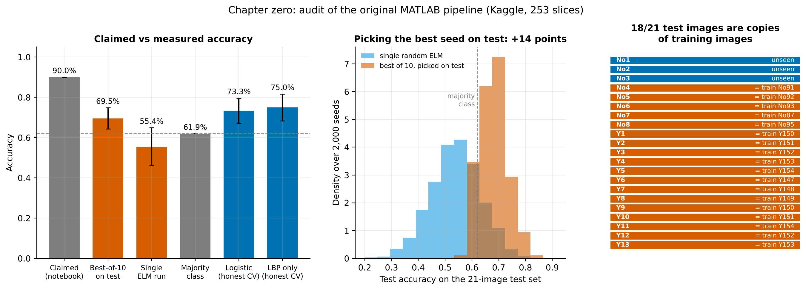

# Chapter zero: audit of the original pipeline

The first version of this repository (2023, now in `legacy/`) classified the
253-slice Kaggle dataset "Brain MRI Images for Brain Tumor Detection"
(Chakrabarty 2019; 98 no / 155 yes) into tumor / no tumor:

* **MATLAB** (`legacy/matlab`): median filter → Gabor filter bank + 2-component
  Gaussian mixture segmentation → morphology → 3-level Haar DWT + GLCM/statistical
  features of the mask (10) + 59-bin LBP of the slice (59) → extreme learning
  machine with 160 sine hidden units;
* **Python notebook** (`legacy/notebook`): k-means segmentation → GLCM of the
  binary mask + LBP histogram bins → linear SVM and a tanh ELM, reporting 90%.

The saved feature files `legacy/data/Trainsetnew0.5.mat` (250 × 69) and
`Testsetnew0.5.mat` (21 × 69) make the MATLAB result auditable without the
images: the LBP block is a deterministic function of each image, so identical
LBP vectors identify identical images. Everything below is reproduced by
`python scripts/00_legacy_audit.py` (runs in CI).

## What was wrong

**Evaluation**

1. **Test images were training images.** 18 of the 21 test images are copies of
   training images (No4–No8 = training No87–No95; all 13 tumor test images =
   training Y147–Y154). The 13 tumor test images are only 8 distinct images.
2. **The model was selected on the test set.** `main.m` trains 10 randomly
   initialised ELMs and reports the one with the best *test* accuracy, then
   discards it if test accuracy exceeds training accuracy and takes the next.
3. **The training set contains 29 identical-image pairs**, so even a correct
   random split would leak.
4. **Notebook:** each test image is scored twice (`for cls in classes` loops over
   the same folder), the confusion-matrix axis labels are swapped, and 64 of 250
   training images are silently dropped by a `.jpg`-only filter.

**Features**

5. "Inverse difference moment" was computed over *pixel coordinates* of the DWT
   coefficient matrix instead of the GLCM, reaching values of 737 and dominating
   an unscaled sine ELM.
6. "Smoothness" used the sum instead of the variance and is constant
   (0.9992–0.9999).
7. The Gaussian-mixture cluster labels are arbitrary, so the "tumor" mask is
   randomly inverted; three rows correspond to all-foreground masks.
8. `importdata.m` shadows a MATLAB built-in; no seeds anywhere; hard-coded paths.

## Measured effect

<!-- TABLE:legacy -->
| Protocol | Accuracy | Note |
|---|---|---|
| Accuracy reported by the original notebook | 90.0% | image-level split, test images counted twice |
| ELM, best of 10 seeds chosen on the test set (main.m) | 69.5% | max 85.7% over 200 repetitions |
| ELM, a single seed, original split | 55.4% ± 9.4 | 2,000 seeds |
| Majority class on the original test set | 61.9% | always 'tumor' |
| ELM as configured, 5-fold CV grouped by duplicate image | 54.4% | 225 unique images |
| ELM without the broken IDM feature, 20 hidden units | 71.4% |  |
| Logistic regression, all 69 features | 73.3% |  |
| Logistic regression, LBP only (no segmentation) | 75.0% |  |
| Logistic regression, segmentation-derived features only | 65.9% |  |

18 of 21 test images are copies of training images (identical LBP feature vectors); the 13 tumor test images are only 8 distinct images; the training set contains 29 identical pairs.
<!-- /TABLE:legacy -->

## Context

An independent 2026 audit of the public Kaggle brain-tumor corpora (Vangala et
al., arXiv:2610.00421, preprint) reaches the same conclusion for this dataset
family. 123 of the 253 images here (48.6%) have a near-duplicate in the larger
Nickparvar corpus, 66 of them byte-identical, so only 130 usable images remain
after cleaning. On the Nickparvar corpus, features of the file header alone
separate tumor from no-tumor images at 0.959 balanced accuracy. Classifiers can
also succeed on the Figshare brain-tumor dataset without looking at the tumor at
all: with the tumor occluded, tumor-type accuracy stays at 0.87, against 0.86 on
the full slice (Wallis & Buvat, *Medical Image Analysis* 2022). A tumor/no-tumor dataset whose
two classes come from different sources cannot show whether a model recognises
tumors. This is why the main study in this repository uses a cohort where tumor and
tumor-free slices come from the same patients and scanners.
