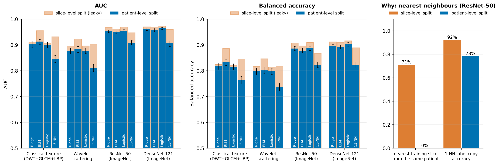
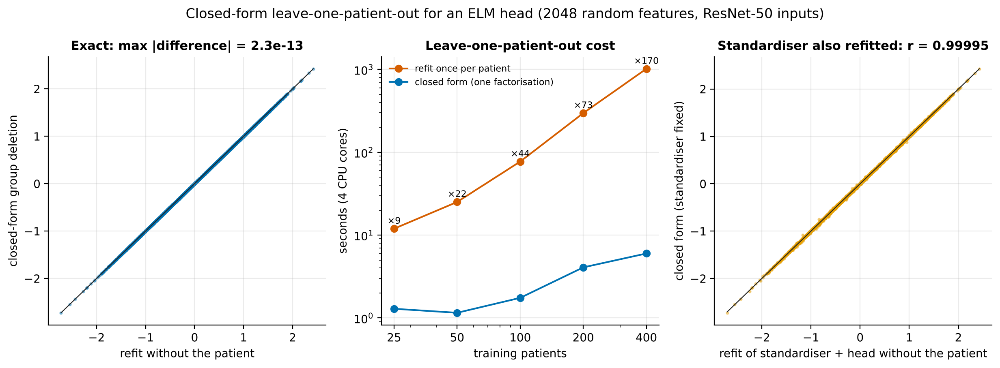
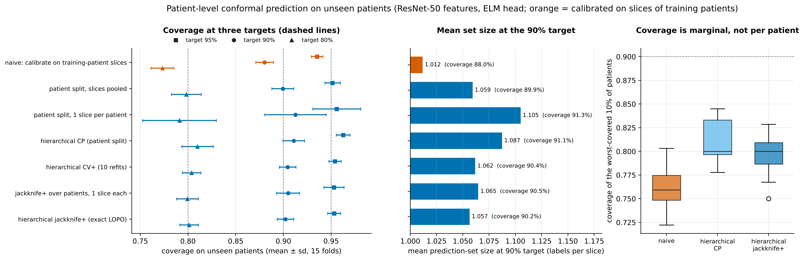
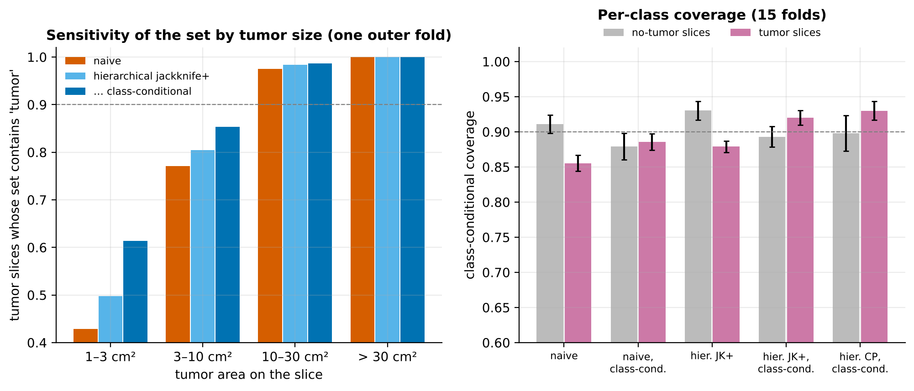
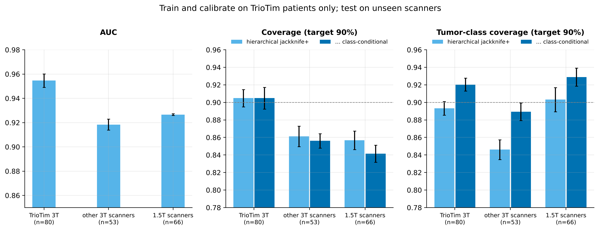
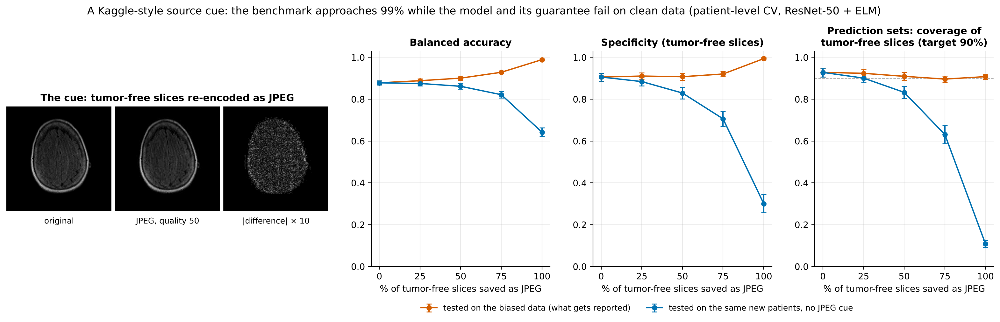
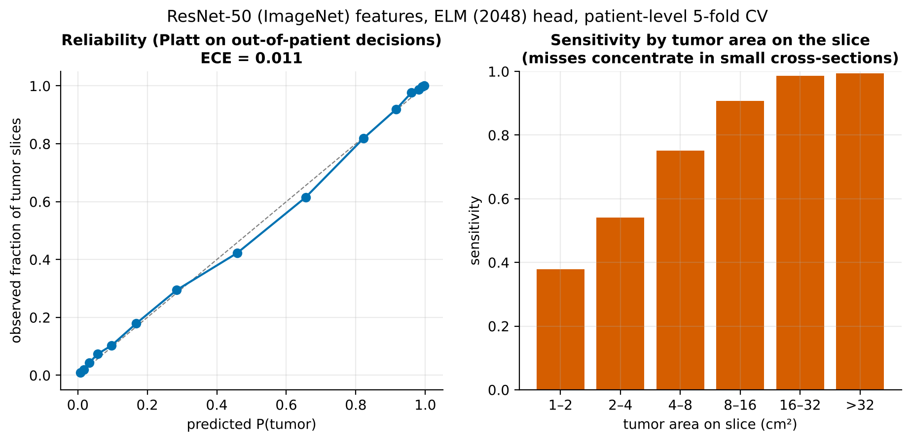

# Results

All numbers on this page are inserted by `scripts/11_tables.py` from the files in
`results/`; all figures are drawn by `scripts/09_figures.py` and
`scripts/10_animations.py` from the same files. Nothing is typed by hand.

## 1. Leakage: slice-level vs patient-level evaluation

519 patients, 17,147 slices, 5-fold cross-validation. Hyper-parameters are
tuned inside each training fold with the same unit as the outer split. 95% CIs
come from 500 patient-level bootstrap resamples.

<!-- TABLE:benchmark -->
| Features | Head | AUC, slice split | AUC, patient split [95% CI] | bAcc %, slice split | bAcc %, patient split [95% CI] | Inflation (bAcc pts) | ECE, patient split |
|---|---|---|---|---|---|---|---|
| Classical texture (DWT+GLCM+LBP) | Ridge | 0.911 | **0.903** [0.892, 0.913] | 82.5 | **81.9** [80.6, 83.1] | +0.6 | 0.016 |
| Classical texture (DWT+GLCM+LBP) | ELM | 0.956 | **0.913** [0.903, 0.922] | 88.7 | **83.2** [82.1, 84.3] | +5.5 | 0.020 |
| Classical texture (DWT+GLCM+LBP) | Logistic | 0.907 | **0.900** [0.889, 0.910] | 82.2 | **81.5** [80.3, 82.7] | +0.6 | 0.023 |
| Classical texture (DWT+GLCM+LBP) | 15-NN | 0.932 | **0.846** [0.833, 0.859] | 84.6 | **76.5** [75.2, 77.8] | +8.1 | 0.051 |
| Wavelet scattering | Ridge | 0.896 | **0.878** [0.866, 0.888] | 81.8 | **79.8** [78.6, 81.0] | +2.0 | 0.012 |
| Wavelet scattering | ELM | 0.923 | **0.883** [0.871, 0.894] | 84.7 | **80.3** [79.1, 81.5] | +4.4 | 0.011 |
| Wavelet scattering | Logistic | 0.897 | **0.878** [0.867, 0.889] | 81.5 | **79.9** [78.7, 81.1] | +1.7 | 0.015 |
| Wavelet scattering | 15-NN | 0.902 | **0.811** [0.797, 0.825] | 81.7 | **73.7** [72.3, 75.1] | +8.0 | 0.038 |
| ResNet-50 (ImageNet) | Ridge | 0.968 | **0.953** [0.948, 0.958] | 90.8 | **88.6** [87.8, 89.5] | +2.1 | 0.012 |
| ResNet-50 (ImageNet) | ELM | 0.962 | **0.949** [0.944, 0.955] | 89.7 | **87.8** [87.0, 88.7] | +1.9 | 0.011 |
| ResNet-50 (ImageNet) | Logistic | 0.970 | **0.955** [0.950, 0.959] | 91.1 | **88.7** [87.9, 89.6] | +2.4 | 0.017 |
| ResNet-50 (ImageNet) | 15-NN | 0.948 | **0.909** [0.900, 0.918] | 86.7 | **82.4** [81.4, 83.4] | +4.3 | 0.021 |
| DenseNet-121 (ImageNet) | Ridge | 0.971 | **0.961** [0.957, 0.966] | 91.2 | **89.6** [88.8, 90.3] | +1.7 | 0.010 |
| DenseNet-121 (ImageNet) | ELM | 0.969 | **0.958** [0.953, 0.963] | 91.0 | **89.2** [88.5, 90.0] | +1.7 | 0.010 |
| DenseNet-121 (ImageNet) | Logistic | 0.973 | **0.965** [0.960, 0.969] | 91.7 | **90.3** [89.6, 90.9] | +1.4 | 0.011 |
| DenseNet-121 (ImageNet) | 15-NN | 0.961 | **0.906** [0.895, 0.916] | 88.9 | **82.3** [81.1, 83.5] | +6.6 | 0.027 |
<!-- /TABLE:benchmark -->

## 2. Exact leave-one-patient-out

## 3. Patient-level conformal prediction (ResNet-50 features, ELM head)

5 outer patient folds × 3 repeats; the held-out fold plays the role of new
patients. Mean ± sd over the 15 folds.

<!-- TABLE:conformal -->
| Calibration (target 90% coverage) | Coverage on new patients | No-tumor class | Tumor class (sensitivity) | Worst-decile patient | Mean set size | Singletons |
|---|---|---|---|---|---|---|
| Naive: calibrate on training-patient slices | 88.0 ± 0.9 | 91.1 | 85.5 | 76.0 | 1.012 | 98.6% |
| Patient split, slices pooled | 89.9 ± 1.1 | 92.7 | 87.7 | 79.0 | 1.059 | 94.1% |
| Patient split, one slice per patient (Dunn et al.) | 91.3 ± 3.2 | 93.8 | 89.3 | 81.4 | 1.105 | 88.7% |
| Hierarchical CP (Lee et al.), patient split | 91.1 ± 1.1 | 93.7 | 89.0 | 81.0 | 1.087 | 91.3% |
| Jackknife+ over patients (exact LOPO), one slice each | 90.5 ± 1.2 | 93.4 | 88.1 | 80.0 | 1.065 | 93.5% |
| **Hierarchical jackknife+ (exact LOPO)** | 90.2 ± 0.9 | 93.0 | 87.9 | 79.6 | 1.057 | 94.3% |
| Hierarchical CV+ (10 refitted models) | 90.4 ± 0.9 | 93.3 | 88.1 | 80.1 | 1.062 | 93.8% |
| Naive, class-conditional | 88.0 ± 1.1 | 87.9 | 88.6 | 75.5 | 1.016 | 98.4% |
| Hierarchical CP, class-conditional | 91.3 ± 1.5 | 89.8 | 93.0 | 80.4 | 1.107 | 89.3% |
| **Hierarchical jackknife+, class-conditional** | 90.5 ± 0.9 | 89.3 | 92.0 | 78.4 | 1.076 | 92.4% |
<!-- /TABLE:conformal -->

All four feature × head configurations at the 90% target (mean over 15 folds):

<!-- TABLE:conformal_configs -->
| Features | Head | Naive: coverage / size | Hierarchical CP: coverage / size | Hierarchical jackknife+: coverage / size | CV+ (10 refits): coverage / size | Folds below target: naive / jackknife+ |
|---|---|---|---|---|---|---|
| Classical texture (DWT+GLCM+LBP) | Ridge | 89.0 / 1.17 | 91.1 / 1.23 | 90.2 / 1.20 | 90.3 / 1.21 | 11 / 7 of 15 |
| Classical texture (DWT+GLCM+LBP) | ELM | 86.5 / 1.08 | 91.2 / 1.21 | 90.2 / 1.17 | 90.5 / 1.18 | 15 / 9 of 15 |
| ResNet-50 (ImageNet) | Ridge | 87.5 / 0.98 | 91.2 / 1.07 | 90.2 / 1.03 | 90.5 / 1.04 | 15 / 5 of 15 |
| ResNet-50 (ImageNet) | ELM | 88.0 / 1.01 | 91.1 / 1.09 | 90.2 / 1.06 | 90.4 / 1.06 | 15 / 3 of 15 |
<!-- /TABLE:conformal_configs -->

## 4. Scanner shift

Trained and calibrated on TrioTim (3 T) patients only, 5 repeats.

<!-- TABLE:shift -->
| Test domain | Patients | AUC | bAcc % | Calibration | Coverage | No-tumor class | Tumor class | Worst-decile patient | Set size |
|---|---|---|---|---|---|---|---|---|---|
| TrioTim 3T (in-distribution) | 80 | 0.955 | 88.6 | Hierarchical jackknife+ (exact LOPO) | 90.5 | 91.9 | 89.3 | 79.7 | 1.05 |
| TrioTim 3T (in-distribution) | 80 | 0.955 | 88.6 | Hierarchical jackknife+, class-conditional | 90.5 | 88.3 | 92.0 | 78.6 | 1.05 |
| 1.5T scanners | 66 | 0.927 | 84.2 | Hierarchical jackknife+ (exact LOPO) | 85.7 | 82.7 | 90.3 | 68.1 | 1.05 |
| 1.5T scanners | 66 | 0.927 | 84.2 | Hierarchical jackknife+, class-conditional | 84.1 | 77.6 | 92.9 | 65.6 | 1.06 |
| other 3T scanners | 53 | 0.918 | 84.0 | Hierarchical jackknife+ (exact LOPO) | 86.1 | 89.0 | 84.6 | 70.7 | 1.06 |
| other 3T scanners | 53 | 0.918 | 84.0 | Hierarchical jackknife+, class-conditional | 85.6 | 84.8 | 88.9 | 68.4 | 1.07 |
<!-- /TABLE:shift -->

## 5. A controlled Kaggle-style shortcut

A fraction of the tumor-free slices is re-encoded as JPEG (quality 50); models are
trained and calibrated with patient-level 5-fold CV on the biased data and tested on
the held-out patients with and without the cue (mean over 5 folds).

<!-- TABLE:shortcut -->
| Tumor-free slices saved as JPEG | Tested on | AUC | bAcc % | Specificity % | Set coverage % | Coverage, tumor-free % |
|---|---|---|---|---|---|---|
| 0% | biased data | 0.949 | 87.8 | 90.6 | 90.0 | 92.8 |
| 0% | clean data | 0.949 | 87.8 | 90.6 | 90.0 | 92.8 |
| 25% | biased data | 0.957 | 88.8 | 91.1 | 89.9 | 92.4 |
| 25% | clean data | 0.948 | 87.5 | 88.4 | 88.8 | 90.1 |
| 50% | biased data | 0.967 | 90.1 | 90.7 | 90.1 | 90.9 |
| 50% | clean data | 0.944 | 86.2 | 82.9 | 86.3 | 83.3 |
| 75% | biased data | 0.980 | 92.9 | 92.0 | 90.3 | 89.6 |
| 75% | clean data | 0.935 | 82.1 | 70.6 | 77.3 | 63.1 |
| 100% | biased data | 0.999 | 98.9 | 99.4 | 90.1 | 90.8 |
| 100% | clean data | 0.840 | 64.2 | 30.1 | 50.0 | 10.8 |
<!-- /TABLE:shortcut -->

## 6. Calibration and tumor size

## 7. Chapter zero

<!-- TABLE:legacy -->
| Protocol | Accuracy | Note |
|---|---|---|
| Accuracy reported by the original notebook | 90.0% | image-level split, test images counted twice |
| ELM, best of 10 seeds chosen on the test set (main.m) | 69.5% | max 85.7% over 200 repetitions |
| ELM, a single seed, original split | 55.4% ± 9.4 | 2,000 seeds |
| Majority class on the original test set | 61.9% | always 'tumor' |
| ELM as configured, 5-fold CV grouped by duplicate image | 54.4% | 225 unique images |
| ELM without the broken IDM feature, 20 hidden units | 71.4% |  |
| Logistic regression, all 69 features | 73.3% |  |
| Logistic regression, LBP only (no segmentation) | 75.0% |  |
| Logistic regression, segmentation-derived features only | 65.9% |  |

18 of 21 test images are copies of training images (identical LBP feature vectors); the 13 tumor test images are only 8 distinct images; the training set contains 29 identical pairs.
<!-- /TABLE:legacy -->
